<p align="center">
  <a href="https://codexapp.agentsmirror.com">
    
  </a>
</p>

> 保护 Windows 便携版安装目录内的用户文件，新增 Codex 启动环境变量与最小化到托盘，并恢复 Codex 26.1111+ 皮肤热应用。
> Protect user files inside Windows portable installs, add Codex launch environment variables and system tray minimization, and restore live skin updates on Codex 26.1111+.

## ✨ 亮点 · Highlights

- **Windows 便携版用户文件保护**：便携版默认工作目录改为用户主目录（`USERPROFILE`）；升级、崩溃恢复与卸载（含系统“已安装的应用”卸载入口）均按官方文件清单识别并仅清理官方程序文件，未知用户文件与目录将原地保留或自动迁入同级 `Codex-Preserved-Files-<时间戳>` 目录。
  Portable Codex now launches with `USERPROFILE` as its default working directory. Upgrades, crash recovery, and uninstalls (including Windows Installed Apps) check against the official file list and remove only Codex program files, preserving unrecognized user files in place or moving them safely to a sibling `Codex-Preserved-Files-<timestamp>` folder.
- **Windows Codex 启动环境变量**：支持在设置页为 Windows 版 Codex 配置独立代理、自定义 CA 证书等启动环境变量，注入子进程时保留原始键名大小写，并内置高危系统路径与进程注入变量安全拦截。
  Configure custom launch environment variables (such as proxy and custom CA certificate settings) for Windows Codex in Settings, preserving original key casing while blocking unsafe system and process-injection variables.
- **最小化到系统托盘**：支持在关闭主窗口时最小化至系统托盘常驻运行，可随时从托盘菜单快速呼出或退出。
  Minimize the main window to the system tray on close and reopen or quit directly from the tray menu.

## 🐛 修复 · Fixes

- **Codex 26.1111+ 皮肤热应用**：适配新版 Codex 的 Rspack 构建产物结构并升级并发桥接扫描，恢复实时皮肤试穿与外观设置热切换。
  Adapt the live theme bridge to Rspack-bundled Codex 26.1111+ builds with concurrent port scanning, restoring live skin previews and instant appearance switching.
- **Windows 便携版暂存目录自动回收**：安装或升级成功及异常中断退出时自动清理本次 `.codex-app-manager-staging` 临时目录，并在管理器启动时补扫便携安装父目录下的过期残留目录。
  Automatically clean up `.codex-app-manager-staging` work directories on both normal completion and early error exits, and sweep stale portable staging folders on Manager startup.
- **便携版启动自检与快捷方式图标**：将便携版首次启动健康自检超时窗口放宽至 120 秒以兼容首启较慢的设备，并修复跨目录布局升级后的开始菜单与任务栏快捷方式图标引用。
  Extend the portable startup health-check window to 120 seconds for slower machines and repair Start Menu and taskbar shortcut icons across portable layout transitions.

## 📦 安装与升级 · Install & Upgrade

**已经安装?** 打开应用即可收到本次更新，macOS 只下载版本间的增量，校验失败自动回滚。
**Already installed?** The app offers this update in-app; macOS pulls only the delta, with automatic rollback.

| 平台 · Platform | 下载 · Download(国内直连 · China-reachable) |
| --- | --- |
| macOS · Apple Silicon | [CodexAppManager_aarch64.dmg](https://codexapp.agentsmirror.com/manager/latest/CodexAppManager_aarch64.dmg) |
| macOS · Intel | [CodexAppManager_x86_64.dmg](https://codexapp.agentsmirror.com/manager/latest/CodexAppManager_x86_64.dmg) |
| Windows · x64 | [CodexAppManager_x64-setup.exe](https://codexapp.agentsmirror.com/manager/latest/CodexAppManager_x64-setup.exe) |
| Windows · ARM64 | [CodexAppManager_arm64-setup.exe](https://codexapp.agentsmirror.com/manager/latest/CodexAppManager_arm64-setup.exe) |

**Windows 签名状态:** 本版安装器没有 Authenticode 代码签名,首次运行可能出现 SmartScreen 提示。`.sig` / `latest.json` 的 Tauri updater 字节签名用于验证更新文件,不代表 Windows 发行者身份。SignPath Foundation 申请已不再推进,项目改为采用付费云 HSM 证书;证书配置完成前发布保持未签名。参见 [代码签名政策](https://github.com/Wangnov/Codex-App-Manager/blob/main/docs/code-signing-policy.md)与 [Windows signing and verification](https://github.com/Wangnov/Codex-App-Manager/blob/main/docs/windows-signing.md)。
**Windows signing status:** This release's installers are not Authenticode-signed, so SmartScreen may warn on first run. Tauri updater signatures in `.sig` / `latest.json` verify update files and do not establish Windows publisher identity. The SignPath Foundation application is no longer being pursued; the project is moving to a paid cloud-HSM certificate, and releases stay unsigned until one is configured. See the [code signing policy](https://github.com/Wangnov/Codex-App-Manager/blob/main/docs/code-signing-policy.md) and [Windows signing and verification](https://github.com/Wangnov/Codex-App-Manager/blob/main/docs/windows-signing.md).

**隐私 · Privacy:** [隐私政策 · Privacy policy](https://github.com/Wangnov/Codex-App-Manager/blob/main/docs/privacy.md)

**核验下载:** 本页 Assets 带有 `SHA256SUMS`;Windows 用 `Get-FileHash .\CodexAppManager_x64-setup.exe -Algorithm SHA256` 或替换为 ARM64 文件名,macOS 用 `shasum -a 256 CodexAppManager_aarch64.dmg`,再与 `SHA256SUMS` 比对。
**Verify downloads:** This release includes `SHA256SUMS` in Assets; on Windows run `Get-FileHash .\CodexAppManager_x64-setup.exe -Algorithm SHA256` or swap in the ARM64 filename, and on macOS run `shasum -a 256 CodexAppManager_aarch64.dmg`, then compare with `SHA256SUMS`.

```bash
# macOS · Homebrew
brew install --cask wangnov/tap/codex-app-manager
```

> 镜像直链恒指向**最新**版本;如需本页对应的历史版本,请使用下方 Assets。`.app.tar.gz` / `.sig` / `latest.json` 是自动更新器的工件,手动安装请选 `.dmg` / `.exe`。
> Mirror permalinks always resolve to the **latest** release; for this exact version use the assets below. `.app.tar.gz` / `.sig` / `latest.json` belong to the auto-updater; pick the `.dmg` / `.exe` for manual installs.
