<p align="center">
  <a href="https://codexapp.agentsmirror.com">
    
  </a>
</p>

> 增强更新元数据与安装包下载的断连自动重试，修复 Windows 便携版单实例锁冲突与回滚文件锁异常，并支持在重试安装前自动恢复未完成的回滚事务。
> Add automatic retries for interrupted metadata and installer transfers, fix Windows portable single-instance handoff and rollback file-lock failures, and automatically recover pending rollback transactions before retrying an install.

## 🐛 修复 · Fixes

- **更新检查与安装包传输断连重试（#514）**：为 Windows 与 macOS 元数据拉取（`manifest`、`checksums`、`appcast`）及 Windows 安装包下载增加瞬时网络中断自动重试（涵盖 `curl exit=18` 半截断流、连接重置与超时等场景，下载中断后自动启用断点续传），并将残余 `exit=18` 准确归类为网络连接异常提示。
  Automatically retry transient transport interruptions (including `curl exit=18` partial transfers, connection resets, and timeouts, with automatic byte-range resume for partial package downloads) across metadata fetches and Windows package downloads, and classify persistent `exit=18` errors under the network diagnostic category.
- **Windows 便携版健康自检与回滚防锁死（#513）**：进入便携版回退安装前全面清理残留的 MSIX 与便携版 Codex 进程；当新安装的便携版在启动自检时因后台残留实例持有单实例锁而立即以 `exit=0` 退出时，自动清理残留进程并重试一次自检；回滚删除失败目录前先优雅关闭目录内子进程并采用退避重试，避免因瞬时句柄占用报 `os error 5`（拒绝访问）。
  Sweep lingering MSIX and portable Codex processes before portable fallback; automatically clear remaining Codex instances and retry once if the portable startup health check exits immediately with `exit=0` due to an existing single-instance lock; and gracefully close child processes plus retry directory removal on rollback to prevent transient `os error 5` lock failures.
- **未完成安装事务在线自愈（#513）**：在用户重新点击更新或安装历史版本前自动执行待恢复事务自愈，并对 Windows 便携版事务回滚启用带退避重试的目录清理与还原，无需重启管理器即可从中断的 `rolling-back` 状态恢复。
  Run pending install-transaction recovery automatically before starting a new Windows update or historical install, using retry-backed directory removal and rename on portable rollbacks so interrupted `rolling-back` states recover cleanly without restarting Manager.

## 📦 安装与升级 · Install & Upgrade

**已经安装?** 打开应用即可收到本次更新，macOS 只下载版本间的增量，校验失败自动回滚。
**Already installed?** The app offers this update in-app; macOS pulls only the delta, with automatic rollback.

| 平台 · Platform | 下载 · Download(国内直连 · China-reachable) |
| --- | --- |
| macOS · Apple Silicon | [CodexAppManager_aarch64.dmg](https://codexapp.agentsmirror.com/manager/latest/CodexAppManager_aarch64.dmg) |
| macOS · Intel | [CodexAppManager_x86_64.dmg](https://codexapp.agentsmirror.com/manager/latest/CodexAppManager_x86_64.dmg) |
| Windows · x64 | [CodexAppManager_x64-setup.exe](https://codexapp.agentsmirror.com/manager/latest/CodexAppManager_x64-setup.exe) |
| Windows · ARM64 | [CodexAppManager_arm64-setup.exe](https://codexapp.agentsmirror.com/manager/latest/CodexAppManager_arm64-setup.exe) |

**Windows 签名状态:** 本版安装器没有 Authenticode 代码签名,首次运行可能出现 SmartScreen 提示。`.sig` / `latest.json` 的 Tauri updater 字节签名用于验证更新文件,不代表 Windows 发行者身份。SignPath Foundation 申请已不再推进,项目改为采用付费云 HSM 证书;证书配置完成前发布保持未签名。参见 [代码签名政策](https://github.com/Wangnov/Codex-App-Manager/blob/main/docs/code-signing-policy.md)与 [Windows signing and verification](https://github.com/Wangnov/Codex-App-Manager/blob/main/docs/windows-signing.md)。
**Windows signing status:** This release's installers are not Authenticode-signed, so SmartScreen may warn on first run. Tauri updater signatures in `.sig` / `latest.json` verify update files and do not establish Windows publisher identity. The SignPath Foundation application is no longer being pursued; the project is moving to a paid cloud-HSM certificate, and releases stay unsigned until one is configured. See the [code signing policy](https://github.com/Wangnov/Codex-App-Manager/blob/main/docs/code-signing-policy.md) and [Windows signing and verification](https://github.com/Wangnov/Codex-App-Manager/blob/main/docs/windows-signing.md).

**隐私 · Privacy:** [隐私政策 · Privacy policy](https://github.com/Wangnov/Codex-App-Manager/blob/main/docs/privacy.md)

**核验下载:** 本页 Assets 带有 `SHA256SUMS`;Windows 用 `Get-FileHash .\CodexAppManager_x64-setup.exe -Algorithm SHA256` 或替换为 ARM64 文件名,macOS 用 `shasum -a 256 CodexAppManager_aarch64.dmg`,再与 `SHA256SUMS` 比对。
**Verify downloads:** This release includes `SHA256SUMS` in Assets; on Windows run `Get-FileHash .\CodexAppManager_x64-setup.exe -Algorithm SHA256` or swap in the ARM64 filename, and on macOS run `shasum -a 256 CodexAppManager_aarch64.dmg`, then compare with `SHA256SUMS`.

```bash
# macOS · Homebrew
brew install --cask wangnov/tap/codex-app-manager
```

> 镜像直链恒指向**最新**版本;如需本页对应的历史版本,请使用下方 Assets。`.app.tar.gz` / `.sig` / `latest.json` 是自动更新器的工件,手动安装请选 `.dmg` / `.exe`。
> Mirror permalinks always resolve to the **latest** release; for this exact version use the assets below. `.app.tar.gz` / `.sig` / `latest.json` belong to the auto-updater; pick the `.dmg` / `.exe` for manual installs.
